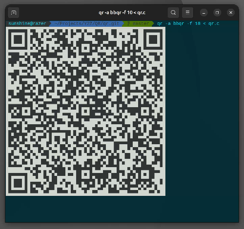

# qr

Print (animated) QR codes straight in your terminal

## Usage

    $ qr "Hello"
or

    $ echo -n "Hello" | qr

#### Options

    Usage: qr [OPTIONS] STRING
    or:  cat FILE | qr [OPTIONS]

    Options:
    -m  QR mode       [na8k] (n = number, a = alphabet, 8 = 8-bit, k = Kanji)
    -v  QR version    [1-40] (the default is 10 for -a)
    -e  QR EC level   [lmqh] or [1-4]
    -l  use two characters per block
    -c  compact mode
    -b  border width  [1-4] (the default is 1)
    -i  invert colors
    -p  force colorless output
    -u  ensure output has UTF-8 BOM
    -a  animate data  [bbqr|bbqr-hex|bbqr-base32|bbqr-zlib|ur|numbered|txqr]
    -t  data type     [auto|psbt|tx|json|cbor|text|binary] (for -a)
    -f  frame rate    [1-30] (frames per second, the default is 4)
    -n  number of frames to output (for -a)
    -r  print frame contents instead of QR codes (for -a)
    -h  print help info and exit
    -V  print version info and exit

## Animated QR Codes

Data that is too large for a single QR Code can be split into a series of
smaller ones that play as an animation, which phones and hardware wallets
scan one frame after another.  This is how air-gapped Bitcoin wallets pass
around PSBTs and transactions, but works for any file.

    $ qr -a bbqr < transaction.psbt

In a terminal the frames loop in place until you press Ctrl+C.  When the
output is not a terminal, every frame is printed once, one after another.
With `-r` the content of each frame is printed instead of QR Codes, each
followed by a newline, which is handy for piping into other tools (TXQR
frames are binary and may contain newlines themselves).

There are several formats, and the one to use is whichever the receiving
wallet or app can scan:

Format     | `-a`       | Fountain codes | Typical scanners
-----------|------------|----------------|-------------------------------------
BBQr       | `bbqr`     | no             | COLDCARD Q, Sparrow Wallet, Nunchuk
UR         | `ur`       | yes            | Sparrow Wallet, Keystone, Passport, SeedSigner, Jade
pMofN      | `numbered` | no             | Specter Desktop, Specter DIY, Krux
TXQR       | `txqr`     | yes            | txqr-reader

Without fountain codes every frame has to be caught at least once, so a
missed frame means waiting for the loop to come around again.  With fountain
codes any frames will do, as long as there are enough of them.

 - `-v` sets the QR version of every frame (10 by default, 57×57 modules).
   Lower versions are easier to scan but need more frames.
 - `-f` sets the frame rate (4 frames per second by default).
 - `-n` sets how many frames to output.  The animation then stops by itself
   instead of looping, and when printing frames (rather than playing them)
   the sequence repeats, or for fountain codes keeps generating new frames.
 - `-e`, `-c`, `-l`, `-i` and `-b` work the same way as for single QR Codes.
 - `-t` tells what kind of data it is.  By default PSBTs are detected
   automatically, whether they are binary, base64 (as printed by Bitcoin Core
   and most wallets) or hex.  Use `-t tx` for a transaction, which can be
   binary or hex.  Anything else is sent as text if it's valid UTF-8, and as
   binary data otherwise.

#### BBQr

[BBQr](https://github.com/coinkite/BBQr) (Better Bitcoin QR) by Coinkite.
Every frame starts with an 8-character header (`B$`, the encoding, the file
type, the number of frames and the frame number), so frames can be scanned in
any order, but every one of them is needed.

    $ qr -a bbqr < transaction.psbt
    $ bitcoin-cli walletprocesspsbt "$psbt" | jq -r .psbt | qr -a bbqr
    $ qr -a bbqr -t tx 0200000001...

 - `bbqr` compresses the data with zlib when that makes it smaller, and uses
   base32 otherwise.  This is what COLDCARD Q recommends.
 - `bbqr-zlib`, `bbqr-base32` and `bbqr-hex` force one encoding.

Scan with: COLDCARD Q, Sparrow Wallet, Nunchuk, Fully Noded, Krux, and other
[wallets compatible with COLDCARD Q](https://coldcard.com/docs/compatible-wallets/).

To check the frames on a computer, use Coinkite's reference decoder:

    $ pip install bbqr
    $ qr -a bbqr -r < transaction.psbt | bbqr decode

#### UR

[Uniform Resources](https://github.com/BlockchainCommons/Research/blob/master/papers/bcr-2020-005-ur.md)
by Blockchain Commons.  Frames look like `UR:CRYPTO-PSBT/7-12/LPAS...`, and
data that fits into a single frame is shown as a plain `UR:CRYPTO-PSBT/...`.

    $ qr -a ur < transaction.psbt

After the first round of frames (one per piece of data), UR keeps generating
new frames that mix several pieces together using
[fountain codes](https://github.com/BlockchainCommons/Research/blob/master/papers/bcr-2024-001-multipart-ur.md),
so the animation never repeats: a scanner that misses some frames catches up
from any later ones, instead of waiting for the whole loop to come around.

PSBTs are sent as `crypto-psbt`, which is what most wallets expect.
Everything else is sent as `bytes`.

Scan with: Sparrow Wallet, Keystone, Foundation Passport, SeedSigner,
Blockstream Jade, Krux and other wallets listed by
[Blockchain Commons](https://developer.blockchaincommons.com/ur/implementations/).

#### Numbered parts (pMofN)

The simplest scheme, used by Specter: the data is split into text parts that
start with `p1of3 `, `p2of3 ` and so on.  PSBTs are sent in base64,
transactions in hex, text as is, and other binary data in base64.

    $ qr -a numbered < transaction.psbt

Every part is needed, in any order.  Krux accepts up to 99 parts.

Scan with: Specter Desktop, Specter DIY and Krux.

#### TXQR

[TXQR](https://github.com/divan/txqr) by Ivan Daniluk, a research project
on transferring files over animated QR codes with fountain codes.  Frames
start with `<block>/<chunk size>/<total size>|`, followed by the data of
several pieces XORed together.

    $ qr -a txqr < notes.txt

The first round of frames is identical to what TXQR's own encoder makes, and
like UR, it then keeps generating new frames instead of repeating.  Data is
sent as text, the same way as for numbered parts.  Since frames carry raw
bytes, plain ASCII text is the safest choice.

Scan with: [txqr-reader](https://github.com/divan/txqr-reader) (iOS).

## Keeping data private

QR Codes often carry secrets (keys, seeds, passwords, PSBTs), so `qr` makes
sure that what it was given doesn't stay behind in memory:

 - All memory it uses is zeroed before being freed or resized, including
   while switching animation frames, and so is the part of the stack it used.
   This covers the QR Code encoder (it's part of `qr`) and zlib's working
   memory too.
 - The data never goes through the C library's I/O buffers.
 - When the data is given as an argument, it's erased from the command line,
   so it doesn't show up in the list of running processes.
 - Core dumps are disabled, and on Linux other processes can't attach to `qr`.
 - Ctrl+C (and termination, hangup or a closed pipe) still wipes everything
   on the way out, and animations are erased from the screen when they stop.

Some things are beyond its reach:

 - Nothing can be cleaned up after `kill -9`, a crash or a power loss, and
   memory may have been written to swap or a hibernation file meanwhile.
 - Your shell may keep arguments in its history: pass secrets through STDIN
   instead, e.g. `qr < secret.txt`.
 - Static QR Codes stay on the screen and in the terminal's scrollback until
   cleared.

## How to install

    # make install
or

    $ sudo PREFIX=/usr/local make install

#### Download

Every [release](https://github.com/Y2Z/qr/releases) comes with standalone
binaries:

 - `qr-linux-x86_64.tar.gz` and `qr-linux-arm64.tar.gz` for Linux, each
   containing a statically linked `qr` that runs on any distribution
 - `qr.exe` for Windows (x86_64)

They have [zlib](https://zlib.net) built in.

#### Build

    $ make

    
<strong>Build dependencies</strong>

     

 - [zlib](https://zlib.net) (the QR Code encoder is built in)
   ###### Resolve on Ubuntu or Debian
       $ apt-get install zlib1g-dev
   ###### Resolve on macOS
       Nothing to do: zlib comes with the system
   ###### Resolve on Windows (in an [MSYS2](https://www.msys2.org) UCRT64 shell)
       $ pacman -S make mingw-w64-ucrt-x86_64-gcc mingw-w64-ucrt-x86_64-zlib
       $ make CC=gcc

#### How to build and install using containers

    $ docker build -t y2z/qr .
    $ sudo install -b utils/qr.sh /usr/local/bin/qr

#### How to build and install on FreeBSD

    $ pkg install qr
or

    $ cd /usr/ports/textproc/qr/
    $ make install clean

## How to remove

    # make uninstall

## Running tests

    $ make test

The tests are a plain shell script, so they can also be run one by one,
e.g. `sh tests.sh 10 36` runs tests 10 and 36.  A failed test leaves what
it did in `tests.tmp/<number>`.

    
<strong>Test dependencies</strong>

     

 - [zbar](http://zbar.sourceforge.net)
   ###### Resolve on Ubuntu or Debian
       $ apt-get install zbar-tools
   ###### Resolve on macOS
       $ brew install zbar
 - [imagemagick](https://www.imagemagick.org/script/index.php)
   ###### Resolve on Ubuntu or Debian
       $ apt-get install imagemagick
   ###### Resolve on macOS
       $ brew install imagemagick
 - [FreeMono font](https://en.wikipedia.org/wiki/GNU_FreeFont)
   ###### Resolve on Ubuntu or Debian
       $ apt-get install fonts-freefont-ttf
   ###### Resolve on macOS
       $ brew tap homebrew/cask-fonts
       $ brew install --cask font-freefont
 - [Python 3](https://www.python.org)
   ###### Resolve on Ubuntu or Debian
       $ apt-get install python3
   ###### Resolve on macOS
       Nothing to do: it comes with the Xcode Command Line Tools

On Windows, in an [MSYS2](https://www.msys2.org) UCRT64 shell:

    $ pacman -S diffutils mingw-w64-ucrt-x86_64-imagemagick mingw-w64-ucrt-x86_64-python mingw-w64-ucrt-x86_64-zbar
    $ make test CC=gcc FONT="$(cygpath -m "$PWD/FreeMono.ttf")"

with `FreeMono.ttf` taken from [GNU FreeFont](https://ftp.gnu.org/gnu/freefont/).

## Acknowledgements

**QR Code** is a registered trademark of DENSO WAVE INCORPORATED in Japan
and other countries.

## License

[Zero-Clause BSD](LICENSE) (0BSD): use, copy, modify and distribute this
software for any purpose, with or without fee, no attribution required.
This software is distributed without any warranty.
